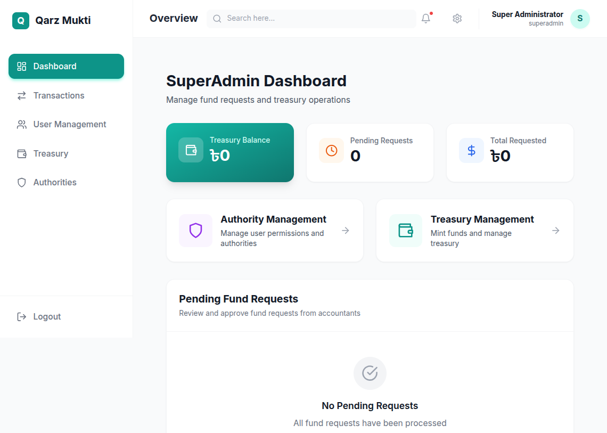
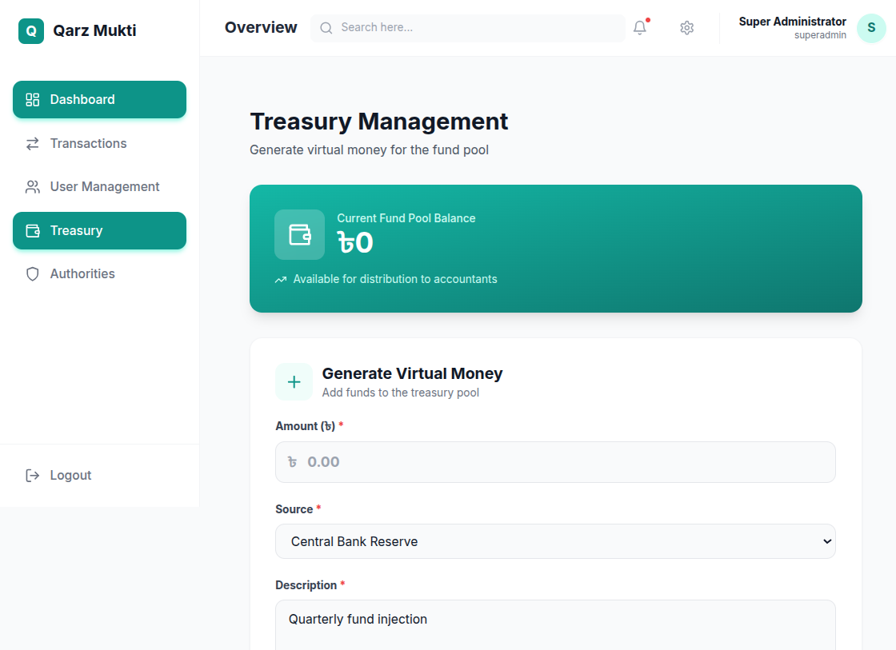
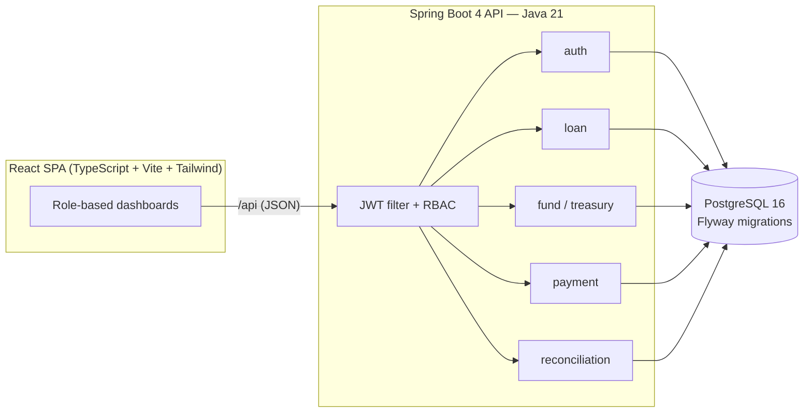

# QarzMukti — Micro-Lending Platform

[](https://github.com/Tutul191020/Micro-Lending-Platform/actions/workflows/ci.yml)


> A core-banking engine for micro-lending operations: borrower onboarding with KYC,
> loan origination, treasury fund management, and a repayment engine that handles
> real-world partial and advance payments — with role-based dashboards for every actor.

---

## Why this project

Small lending organizations (cooperatives, NGOs, community funds) often run their
entire loan book on spreadsheets. That breaks down exactly where money gets tricky:
a borrower pays **less** than the installment one month, or **more** another month,
and nobody can say what is actually owed.

QarzMukti digitizes the full lifecycle — from borrower registration and document
verification to disbursement, collection, and reconciliation — and treats payment
allocation as a first-class domain problem instead of an afterthought.

## Screenshots

| Super Admin dashboard | Treasury management |
|---|---|
|  |  |

## Features

| Module | What it does |
|---|---|
| **Auth & RBAC** | JWT access + refresh tokens, OTP password reset, granular authorities (`LOAN:CREATE`, `PAYMENT:READ`, …) mapped to roles: Super Admin, Admin, Accountant, Borrower |
| **Borrower onboarding** | Registration with KYC documents (national ID, electricity bill, photo), verification workflow, tracked onboarding states |
| **Loan lifecycle** | `PENDING → APPROVED → ACTIVE → FULLY_PAID`, with `REJECTED`, `CANCELLED`, `DEFAULTED` branches; installment schedule generation and monitoring |
| **Interest governance** | System-wide effective-dated rates, per-loan overrides restricted to terminal-status rules, full audit trail of every change |
| **Treasury** | Shared fund pool, fund requests and approvals, disbursement tracking |
| **Payment engine** | Idempotent transactions; exact, partial and advance allocation (details below) |
| **Reconciliation** | Matching gateway transactions against the ledger |
| **Dashboards** | Role-specific React dashboards (Super Admin, Admin, Accountant, Borrower) with charts |

## The interesting part: payment allocation

Real borrowers don't pay exact amounts. The allocation engine
([`PaymentAllocationService`](src/main/java/tutul/ex/QarzMukti/features/payment/PaymentAllocationService.java))
handles three cases:

| Case | Behavior |
|---|---|
| **Exact** | Installment marked `PAID`, single allocation recorded |
| **Underpayment** | Installment marked `PARTIALLY_PAID`; the **deficit is carried forward** to the next installment and flagged, so the next due reflects reality |
| **Overpayment** | Current installment settled; the excess is **distributed proportionally** across future installments as advance payment, with the last installment absorbing rounding residue |

Example: installment due ৳1,000, borrower pays ৳1,600, future installments owe
৳1,000 and ৳2,000 → excess ৳600 splits ৳199.98 / ৳400.02 (proportional, rounding-safe).
Every movement is written as an immutable `PaymentAllocation` row, so the ledger is
always explainable. This logic is covered by unit tests.

## Architecture



Backend is organized **by feature**, not by layer — each feature owns its
controllers and services; entities, DTOs, repositories and security live in a
shared kernel:

```
src/main/java/tutul/ex/QarzMukti/
├── features/
│   ├── auth/          # registration, login, JWT, OTP flows
│   ├── rbac/          # roles & authorities
│   ├── user/          # borrower profiles & KYC documents
│   ├── loan/          # lifecycle, interest rates, monitoring
│   ├── fund/          # fund requests & treasury
│   ├── payment/       # gateway, allocation engine
│   └── reconciliation/
└── shared/            # entities, DTOs, repositories, security, config
```

## Tech stack

- **Backend:** Java 21, Spring Boot 4 (Web MVC, Data JPA, Security, Validation), jjwt 0.12, Lombok
- **Database:** PostgreSQL 16, Flyway migrations
- **Frontend:** React 18, TypeScript, Vite, Tailwind CSS, Recharts, React Router
- **Testing:** JUnit 5, Mockito, AssertJ (15 unit tests on core money logic)
- **CI/CD:** GitHub Actions — backend build + tests, frontend type-check + build
- **Packaging:** Multi-stage Docker builds, Docker Compose (Postgres + API + nginx-served SPA)

## Getting started

### Option A — Docker (one command)

```bash
docker compose up --build
```

| Service | URL |
|---|---|
| Frontend | http://localhost:3000 |
| Backend API | http://localhost:8081 |
| PostgreSQL | localhost:5432 |

**Demo login:** `superadmin` / `Password@101` (seeded on first start).

### Option B — Manual

Prerequisites: JDK 21, Node 20+, PostgreSQL 16.

```bash
# 1. Database
createdb qarz_mukti

# 2. Backend (defaults work for a local postgres; override via env vars)
export DB_USERNAME=postgres DB_PASSWORD=postgres
./mvnw spring-boot:run

# 3. Frontend (proxies /api to :8081)
cd frontend && npm ci && npm run dev   # http://localhost:5173
```

### Configuration

All settings are environment-driven (see [`.env.example`](.env.example)):

| Variable | Default | Purpose |
|---|---|---|
| `DB_URL` | `jdbc:postgresql://localhost:5432/qarz_mukti` | JDBC URL |
| `DB_USERNAME` / `DB_PASSWORD` | `postgres` / `postgres` | Database credentials |
| `JWT_SECRET` | dev-only placeholder | **Set a long random value (≥ 32 chars) in production** |
| `JWT_EXPIRATION` | `86400000` (24 h) | Access-token lifetime (ms) |
| `SERVER_PORT` | `8081` | API port |

## API overview

| Area | Base path | Highlights |
|---|---|---|
| Auth | `/api/v1/auth` | register, login, refresh, logout, change/forgot/reset password, OTP verify |
| Users | `/api/v1/users` | profiles, KYC documents, verification |
| Roles & authorities | `/api/v1/roles`, `/api/v1/authorities` | RBAC administration |
| Loans | `/api/v1/loans` | apply, approve/reject, disburse, schedule, monitoring |
| Payments | `/api/v1/payments` | initiate (idempotent), allocate, history |
| Treasury | `/api/v1/treasury` | fund pool, deposits, disbursements |
| Fund requests | `/api/fund-requests` | request & approval workflow |
| Interest rates | `/api/interest-rates` | system rate, per-loan override, audit history |
| Reconciliation | `/api/reconciliation` | gateway ↔ ledger matching |

## Testing

```bash
./mvnw test
```

Unit tests focus on the money-critical paths: all three allocation strategies
(including deficit carry-forward, proportional advance distribution, rounding and
caps) and interest-rate governance (terminal-status rules, audit trail, fallbacks).

## Roadmap

- [ ] Testcontainers integration tests for repositories and full payment flow
- [ ] Observability: Micrometer + structured logging
- [ ] Rate limiting on auth endpoints
- [ ] Demo deployment with seeded sample loan book

## License

[MIT](LICENSE)
